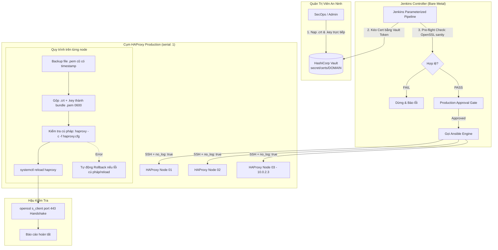

# Hệ Thống Tự Động Hóa Quản Lý & Cập Nhật SSL/TLS Cho HAProxy (Production)

Giải pháp tự động hóa phân phối và cập nhật chứng chỉ SSL/TLS trên cụm HAProxy Production sử dụng **Jenkins (Bare Metal)**, **Ansible** và **HashiCorp Vault**. Thiết kế tuân thủ nguyên tắc **Zero Trust**, **Least Privilege**, đảm bảo reload không gián đoạn dịch vụ (**Zero-Downtime**) và có cơ chế **tự động Rollback**.

---

## 1. Sơ Đồ Kiến Trúc & Luồng Hoạt Động



---

## 2. Cấu Trúc Mã Nguồn

```text
.
├── Jenkinsfile                          # Pipeline tham số hóa (Vault, Approval, Ansible, Zero-Trust)
├── ansible.cfg                          # Cấu hình Ansible tối ưu (pipelining, become, no host_key_checking)
├── group_vars/
│   └── all.yml                          # Tự động nạp cert & key vào RAM từ file tạm của Jenkins
├── inventories/
│   └── prod/
│       └── hosts.yml                    # Danh sách cụm HAProxy Production
├── playbooks/
│   ├── deploy_certs.yml                 # Playbook điều phối chính (serial: 1, backup, reload, verify)
│   └── roles/
│       ├── haproxy_cert/                # Role gộp PEM, backup, syntax check, zero-downtime reload, rollback
│       │   └── tasks/main.yml
│       └── verify_cert/                 # Role kiểm tra bắt tay TLS thời gian thực qua OpenSSL
│           └── tasks/main.yml
└── README.md
```

---

## 3. Hướng Dẫn Cài Đặt & Cấu Hình Chi Tiết
#### Cài đặt Jenkins + Vault on Ubuntu 24.04
```bash
mkdir -p /opt/vault/tls /root/ca
cd /root/ca

# 1. Tạo Root CA (khuyến nghị đặt passphrase hoặc bảo vệ file ca.key)
openssl genrsa -out ca.key 4096
openssl req -x509 -new -nodes -key ca.key -sha256 -days 3650 -out ca.crt -subj "/C=VN/ST=HCM/L=HCM/O=InternalSec/CN=Internal-Vault-Root-CA"

# 2. Tạo file cấu hình SAN cho Vault (sửa IP và DNS cho đúng môi trường)
cat << 'EOF' > vault-san.cnf
[req]
default_bits = 2048
prompt = no
default_md = sha256
req_extensions = req_ext
distinguished_name = dn

[dn]
C = VN
ST = HCM
L = HCM
O = InternalSec
CN = vault.internal

[req_ext]
subjectAltName = @alt_names

[alt_names]
DNS.1 = vault.internal
DNS.2 = localhost
IP.1 = 127.0.0.1
IP.2 = 10.0.2.3
EOF

# 3. Sinh key và ký cert cho Vault bằng Root CA
openssl genrsa -out vault.key 2048
openssl req -new -key vault.key -out vault.csr -config vault-san.cnf
openssl x509 -req -in vault.csr -CA ca.crt -CAkey ca.key -CAcreateserial \
  -out vault.crt -days 8250 -sha256 -extensions req_ext -extfile vault-san.cnf

# 4. Copy cert & key vào thư mục của Vault
sudo cp vault.crt /opt/vault/tls/vault.crt
sudo cp vault.key /opt/vault/tls/vault.key
sudo cp ca.crt /opt/vault/tls/ca.crt

2. Cài đặt và cấu hình HashiCorp Vault (Production)
apt-get update && sudo apt-get install -y gpg curl lsb-release jq

wget -O- https://apt.releases.hashicorp.com/gpg | sudo gpg --dearmor -o /usr/share/keyrings/hashicorp-archive-keyring.gpg

echo "deb [arch=$(dpkg --print-architecture) signed-by=/usr/share/keyrings/hashicorp-archive-keyring.gpg] https://apt.releases.hashicorp.com $(. /etc/os-release && echo "$VERSION_CODENAME") main" | sudo tee /etc/apt/sources.list.d/hashicorp.list

sudo apt-get update && sudo apt-get install -y vault
vault --version

Bước 2.2: Cấu hình /etc/vault.d/vault.hclSử dụng Integrated Storage (raft) và bật TLS trên listener.   
mkdir -p /opt/vault/data
sudo chown -R vault:vault /opt/vault
sudo chmod 600 /opt/vault/tls/vault.key

sudo tee /etc/vault.d/vault.hcl << 'EOF'
ui = true
disable_mlock = false

storage "raft" {
  path    = "/opt/vault/data"
  node_id = "vault-node-1"
}

listener "tcp" {
  address       = "0.0.0.0:8200"
  tls_cert_file = "/opt/vault/tls/vault.crt"
  tls_key_file  = "/opt/vault/tls/vault.key"
  tls_min_version = "tls12"
}

api_addr     = "https://10.0.2.3:8200"
cluster_addr = "https://10.0.2.3:8201"
EOF

sudo chown vault:vault /etc/vault.d/vault.hcl
sudo chmod 640 /etc/vault.d/vault.hcl

Bước 2.3: Tin cậy Self-Managed CA trên Ubuntu & khởi động VaultBash# Cài Root CA vào trust store của hệ điều hành Ubuntu
sudo cp /opt/vault/tls/ca.crt /usr/local/share/ca-certificates/vault-root-ca.crt
sudo update-ca-certificates

# Khởi động Vault
sudo systemctl enable vault
sudo systemctl restart vault
sudo systemctl status vault

# Cấu hình biến môi trường CLI
echo 'export VAULT_ADDR="https://10.0.2.3:8200"' | sudo tee -a /etc/environment
source /etc/environment

Bước 2.4: Khởi tạo (Init) và Unseal VaultChạy vault operator init duy nhất một lần và lưu ngay Unseal Keys + Initial Root Token vào trình quản lý mật khẩu an toàn (không lưu plain-text trên server). 

vault operator init -key-shares=5 -key-threshold=3

# Unseal bằng 3 key bất kỳ (chạy lệnh 3 lần, mỗi lần nhập 1 key)
vault operator unseal
vault operator unseal
vault operator unseal

# Đăng nhập bằng Root Token để cấu hình ban đầu
vault login

4. Cài đặt Jenkins trên Ubuntu 24.04:
sudo apt-get update
sudo apt-get install -y fontconfig openjdk-21-jre

sudo wget -O /usr/share/keyrings/jenkins-keyring.asc \
  https://pkg.jenkins.io/debian-stable/jenkins.io-2026.key

echo "deb [signed-by=/usr/share/keyrings/jenkins-keyring.asc] https://pkg.jenkins.io/debian-stable binary/" | \
  sudo tee /etc/apt/sources.list.d/jenkins.list > /dev/null

sudo apt-get update
sudo apt-get install -y jenkins

# Khởi động Jenkins sau khi đã import CA
sudo systemctl enable jenkins --now
sudo systemctl status jenkins

# Lấy mật khẩu khởi tạo lần đầu
sudo cat /var/lib/jenkins/secrets/initialAdminPassword

5. Kết nối Jenkins với Vault & Sử dụng trong Pipeline:
- Cài Plugin trên Jenkins: Vào Manage Jenkins → Plugins → Available plugins, cài HashiCorp Vault (hashicorp-vault-plugin) và Credentials Binding.- Tạo Credentials trên Jenkins: Vào Manage Jenkins → Credentials → System → Global credentials → Add Credentials.Chọn kind Vault App Role Credential (hoặc Secret text cho Role ID và Secret ID tùy phiên bản plugin), điền Role ID và Secret ID đã lấy ở Bước 3.   
- Cấu hình Vault Server trong Jenkins:Vào Manage Jenkins → System, tìm mục Vault.Vault URL: [https://10.0.2.3:8200](https://10.0.2.3:8200) (khớp với SAN trong cert).Chọn credential AppRole vừa tạo.Bật Ignore SSL certificate errors chỉ khi test tạm; ở production hãy để tắt vì đã import CA vào JVM.
- Ví dụ Jenkinsfile (Declarative Pipeline) đọc secret từ KV v2:   

pipeline {
  agent any

  environment {
    VAULT_ADDR = 'https://10.0.2.3:8200'
  }

  stages {
    stage('Fetch Secrets & Deploy') {
      steps {
        vault(
          configuration: [
            vaultUrl: 'https://10.0.2.3:8200',
            vaultCredentialId: 'vault-jenkins-approle',
            engineVersion: 2
          ],
          vaultSecrets: [
            [
              path: 'cicd/prod/deploy-app',
              engineVersion: 2,
              secretValues: [
                [envVar: 'DEPLOY_USER', vaultKey: 'DEPLOY_USER'],
                [envVar: 'DEPLOY_TOKEN', vaultKey: 'DEPLOY_TOKEN']
              ]
            ]
          ]
        ) {
          sh '''
            set -e
            echo "Deploying as user: $DEPLOY_USER"
            # Dùng $DEPLOY_TOKEN ở đây (không echo ra log)
          '''
        }
      }
    }
  }
}
```
### PHẦN 1: Cấu hình HashiCorp Vault (Production)

#### 1.1. Bật Secret Engine KV v2
Đăng nhập máy chủ Vault và kích hoạt engine lưu secret tại path `secret/`:
```bash
vault secrets enable -path=secret kv-v2
```

#### 1.2. Tạo Policy phân quyền chỉ đọc cho Jenkins (Least Privilege)
Tạo file `jenkins-cert-policy.hcl`:
```hcl
# Chỉ cho phép đọc chứng chỉ tại secret/certs/*
path "secret/data/certs/*" {
  capabilities = ["read"]
}
path "secret/metadata/certs/*" {
  capabilities = ["read", "list"]
}
```
Nạp policy vào Vault:
```bash
vault policy write jenkins-cert-policy jenkins-cert-policy.hcl
```

#### 1.3. Cấp phát Token dài hạn cho Jenkins
```bash
vault token create \
    -policy="jenkins-cert-policy" \
    -orphan=true \
    -renewable=true \
    -period="720h" \
    -display-name="jenkins-cert-prod"
```
> [!IMPORTANT]
> Cờ `-orphan=true` đảm bảo token của Jenkins không bị thu hồi khi session của người tạo token hết hạn. Copy chuỗi token trả về (bắt đầu bằng `hvs.` hoặc `s.`) để nhập vào Jenkins ở bước sau.

#### 1.4. Nạp chứng chỉ mẫu lên Vault
Ghép chứng chỉ domain và Intermediate CA thành file Full Chain trước khi nạp:
```bash
cat domain.crt intermediate-ca.crt > fullchain.crt

vault kv put secret/certs/example.com \
    tls.crt=@fullchain.crt \
    tls.key=@example.com.key
```

---

### PHẦN 2: Cấu hình Máy Chủ Jenkins & Ansible (Bare Metal)

#### 2.1. Cài đặt các công cụ hệ điều hành
Thực hiện trên máy chủ Jenkins Controller:
```bash
# Ubuntu / Debian:
sudo apt-get update
sudo apt-get install -y openjdk-17-jdk python3 python3-pip curl openssl openssh-client git ansible

# RHEL / Rocky Linux:
sudo dnf install -y java-17-openjdk python3 python3-pip curl openssl openssh-clients git
sudo pip3 install ansible
```

#### 2.2. Tạo cặp SSH Key dùng riêng cho tự động hóa
Tạo keypair để Jenkins kết nối tới các máy chủ HAProxy:
```bash
ssh-keygen -t ed25519 -C "jenkins-ansible-automation" -f ~/.ssh/jenkins_deploy_key -N ""
```
- File `jenkins_deploy_key`: Dùng nạp vào Jenkins Credentials.
- File `jenkins_deploy_key.pub`: Dùng nạp vào máy chủ HAProxy.

#### 2.3. Cài đặt Plugin trên Jenkins
Vào **Manage Jenkins** -> **Plugins** -> **Available plugins**, cài đặt 3 plugin sau:
1. **Pipeline** (`workflow-aggregator`)
2. **Credentials Binding Plugin** (`credentials-binding`)
3. **SSH Agent Plugin** (`ssh-agent`)

#### 2.4. Khai báo Credentials trong Jenkins
Vào **Manage Jenkins** -> **Credentials** -> **System** -> **Global credentials (unrestricted)** -> **Add Credentials**:

| Loại Credential (Kind) | ID | Cấu hình & Dữ liệu nhập |
| :--- | :--- | :--- |
| **Secret text** | `vault-token-prod` | Dán chuỗi Token Vault tạo ở mục 1.3 |
| **SSH Username with private key** | `ansible-ssh-deploy-key` | **Username:** `devops`<br>**Private Key:** Dán nội dung file `~/.ssh/jenkins_deploy_key` |

> [!NOTE]
> Mặc định trong `Jenkinsfile` cấu hình `VAULT_ADDR = 'https://vault.internal:8200'`. Nếu địa chỉ Vault của bạn khác, hãy sửa lại giá trị này tại khối `environment` trong `Jenkinsfile`.

---

### PHẦN 3: Cấu hình Máy Chủ HAProxy Production (Ví dụ Node: 10.0.2.3)

Thực hiện các bước sau trên máy chủ HAProxy Ubuntu:

#### 3.1. Cài đặt HAProxy & Khởi tạo User
```bash
# 1. Cài đặt HAProxy
sudo apt-get update && sudo apt-get install -y haproxy openssl
sudo systemctl enable haproxy

# 2. Tạo user devops và cấp quyền sudo không cần mật khẩu
sudo useradd -m -s /bin/bash devops
echo "devops ALL=(ALL) NOPASSWD: ALL" | sudo tee /etc/sudoers.d/devops
sudo chmod 0440 /etc/sudoers.d/devops

# 3. Nạp SSH Public Key của Jenkins
sudo mkdir -p /home/devops/.ssh
echo "dán_nội_dung_file_jenkins_deploy_key.pub_vào_đây" | sudo tee -a /home/devops/.ssh/authorized_keys
sudo chown -R devops:devops /home/devops/.ssh
sudo chmod 700 /home/devops/.ssh
sudo chmod 600 /home/devops/.ssh/authorized_keys
```

#### 3.2. Chuẩn bị thư mục SSL và Cert tạm thời
> [!IMPORTANT]
> HAProxy yêu cầu file cert phải tồn tại tại thời điểm kiểm tra cú pháp cấu hình. Ta sinh một cert tạm để service khởi động thành công lần đầu. Khi pipeline chạy, Jenkins sẽ tự động ghi đè chứng chỉ thật từ Vault vào file này.

```bash
sudo mkdir -p /etc/haproxy/certs
sudo chmod 750 /etc/haproxy/certs

# Sinh cert tạm self-signed cho domain example.com
sudo openssl req -x509 -newkey rsa:2048 -nodes \
    -keyout /tmp/temp.key \
    -out /tmp/temp.crt \
    -days 1 -subj "/CN=example.com"
sudo cat /tmp/temp.crt /tmp/temp.key | sudo tee /etc/haproxy/certs/example.com.pem > /dev/null
sudo chmod 600 /etc/haproxy/certs/example.com.pem
sudo rm -f /tmp/temp.key /tmp/temp.crt
```

#### 3.3. Cấu hình Frontend SSL trong `/etc/haproxy/haproxy.cfg`
Thêm cấu hình lắng nghe HTTPS vào file `/etc/haproxy/haproxy.cfg`:
```haproxy
frontend https_front
    bind *:443 ssl crt /etc/haproxy/certs/example.com.pem
    mode http
    option forwardfor
    http-request set-header X-Forwarded-Proto https
    default_backend web_servers

backend web_servers
    mode http
    balance roundrobin
    server web01 127.0.0.1:8080 check
```

Kiểm tra cú pháp và kích hoạt dịch vụ:
```bash
sudo haproxy -c -f /etc/haproxy/haproxy.cfg
sudo systemctl restart haproxy
```

---

## 4. Khai Báo Inventory

File [inventories/prod/hosts.yml](file:///d:/Antigravity/Cert_automation/inventories/prod/hosts.yml) quản lý danh sách các node HAProxy Production:

```yaml
all:
  vars:
    ansible_user: devops
    ansible_port: 22
    env: prod

  children:
    haproxy_servers:
      hosts:
        haproxy-prod-01.internal:
          ansible_host: 10.100.10.31
          haproxy_cert_dir: /etc/haproxy/certs
          haproxy_service_name: haproxy
        haproxy-prod-02.internal:
          ansible_host: 10.100.10.32
          haproxy_cert_dir: /etc/haproxy/certs
          haproxy_service_name: haproxy
        haproxy-prod-03.internal:
          ansible_host: 10.0.2.3
          haproxy_cert_dir: /etc/haproxy/certs
          haproxy_service_name: haproxy
```

---

## 5. Tạo Job Trên Jenkins & Runbook Vận Hành

### 5.1. Tạo Job trên Jenkins UI
1. Nhấn **New Item** -> đặt tên `SSL-TLS-Cert-Rotation-PROD` -> chọn **Pipeline** -> bấm **OK**.
2. Tại phần **Pipeline**:
   - **Definition:** `Pipeline script from SCM`.
   - **SCM:** `Git`.
   - **Repository URL:** Điền Git repo của dự án.
   - **Branch:** `*/main`.
   - **Script Path:** `Jenkinsfile`.
3. Bấm **Save**.
4. **Lần đầu tiên:** Nhấn **Build Now** một lần để Jenkins quét file và nạp các tham số vào hệ thống. Sau đó F5 tải lại trang, nút **Build with Parameters** sẽ xuất hiện.

---

### 5.2. Runbook: Các bước thay Cert định kỳ

1. **Nạp cert mới vào Vault:** Admin upload file `.crt` và `.key` mới vào path `secret/certs/<DOMAIN>` trên Vault.
2. **Kích hoạt Pipeline:** Vào Job trên Jenkins, chọn **Build with Parameters**:
   - `ENVIRONMENT`: `PROD`
   - `TARGET_SERVERS`:
     - Nhập `haproxy_servers` nếu muốn cập nhật **toàn bộ cụm HAProxy**.
     - Nhập IP hoặc Hostname cụ thể (ví dụ: `10.0.2.3` hoặc `haproxy-prod-03.internal`) nếu chỉ muốn cập nhật **riêng 1 node**.
   - `CERT_DOMAIN`: Tên domain (ví dụ: `example.com`).
   - `ACTION`:
     - Chọn `VALIDATE_ONLY` nếu chỉ muốn kiểm tra cert từ Vault và tính hợp lệ OpenSSL (không can thiệp server).
     - Chọn `DEPLOY` để thực hiện cập nhật.
3. **Phê duyệt (Approval Gate):** Khi `ACTION = DEPLOY`, pipeline dừng chờ xác nhận. Quản trị viên kiểm tra log và bấm **Approve & Deploy to PROD**.
4. **Theo dõi tự động:**
   - Ansible cập nhật tuần tự từng node (`serial: 1`), sao lưu bản cũ, gộp bundle `.pem` với quyền `0600`.
   - Kiểm tra `haproxy -c`, gọi `systemctl reload haproxy` zero-downtime (tự động rollback nếu cú pháp lỗi).
   - Thực hiện TLS handshake cổng 443 bằng OpenSSL để xác thực chứng chỉ đang hoạt động.
   - Workspace Jenkins tự động `shred` toàn bộ file chứng chỉ tạm thời khi kết thúc build.
