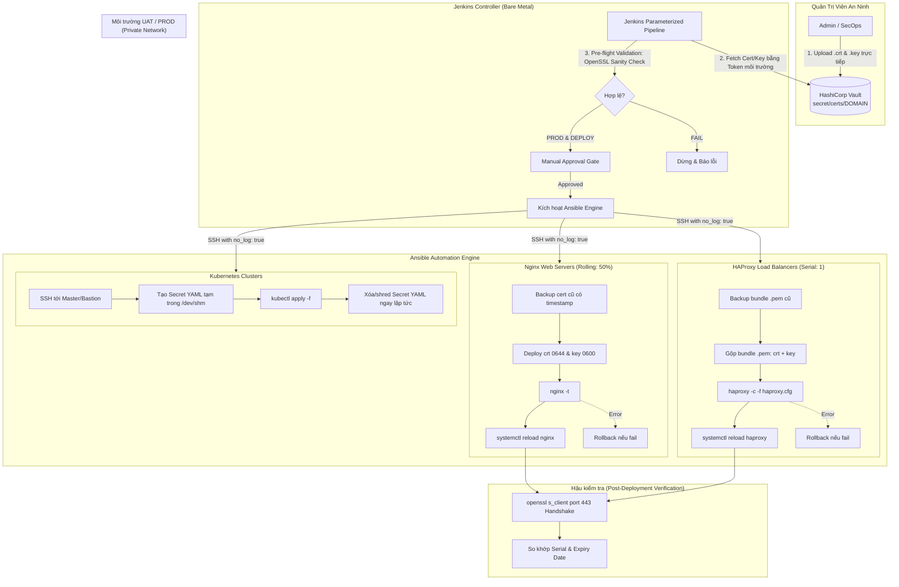

# Enterprise SSL/TLS Certificate Distribution & Automation

Hệ thống tự động hóa quản lý, phân phối và cập nhật chứng chỉ SSL/TLS trên hạ tầng đa nền tảng (Kubernetes, Nginx, HAProxy) tuân thủ các nguyên tắc **DevSecOps**, **Zero Trust**, **Least Privilege** và **Defense in Depth**.

---

## 1. Kiến trúc hệ thống (Architecture Overview)



---

## 2. Các nguyên tắc DevSecOps & Zero Trust cốt lõi

1. **Không rò rỉ Private Key vào CI/CD:**
   - Admin nạp trực tiếp cặp key vào HashiCorp Vault. Không bao giờ truyền Private Key qua tham số (Parameter) của Jenkins hoặc commit vào Git repository.
   - Thư mục tạm trên Jenkins Agent được tạo với quyền `0700` và bị hủy triệt để bằng lệnh `shred -u -z -n 3` trong khối `post { always }`.
2. **Cô lập đặc quyền theo môi trường (Isolation & Least Privilege):**
   - Tách biệt 2 Vault Token trong Jenkins Credential Manager: `vault-token-uat` và `vault-token-prod`.
   - Pipeline tự động chọn đúng Token dựa trên parameter `ENVIRONMENT`.
3. **Phòng vệ theo chiều sâu trong Ansible (Defense in Depth):**
   - Đặt `no_log: true` trên tất cả các task xử lý private key và render secret để ngăn lộ key vào Jenkins console logs.
   - Trên K8s Bastion: Manifest Secret YAML chỉ được tạo trong RAM disk (`/dev/shm`) với quyền `0600`, không ghi xuống ổ đĩa cứng vật lý và bị xóa ngay trong khối `always`.
4. **Độ sẵn sàng cao (High Availability) & Rollback an toàn:**
   - **Nginx:** `serial: 50%` đảm bảo luôn có ít nhất một nửa số node phục vụ lưu lượng; kiểm tra cú pháp `nginx -t` trước khi reload; tự động rollback phiên bản backup nếu cấu hình lỗi.
   - **HAProxy:** `serial: 1` reload từng node load balancer một; kiểm tra `haproxy -c` trước khi reload.
   - **Kubernetes:** Khai báo Secret dưới dạng `kubernetes.io/tls` chuẩn, tương thích với Ingress Controller (Nginx Ingress, Traefik, HAProxy Ingress).

---

## 3. Cấu trúc thư mục dự án

```text
.
├── Jenkinsfile                          # Pipeline chính (Parameterized, Vault, Approval, Ansible)
├── ansible.cfg                          # Cấu hình Ansible tối ưu và bảo mật
├── inventories/
│   ├── uat/
│   │   └── hosts.yml                    # Danh sách server Nginx, HAProxy, K8s Bastion UAT
│   └── prod/
│       └── hosts.yml                    # Danh sách server Nginx, HAProxy, K8s Bastion PROD
├── playbooks/
│   ├── deploy_certs.yml                 # Master playbook điều phối toàn bộ targets
│   └── roles/
│       ├── nginx_cert/                  # Role cập nhật cert cho Nginx
│       │   └── tasks/main.yml
│       ├── haproxy_cert/                # Role cập nhật PEM bundle cho HAProxy
│       │   └── tasks/main.yml
│       ├── k8s_cert/                    # Role cập nhật Secret TLS trên K8s qua Bastion
│       │   ├── tasks/
│       │   │   ├── main.yml
│       │   │   ├── apply_cluster.yml
│       │   │   └── apply_namespace.yml
│       │   └── templates/
│       │       └── tls-secret.yaml.j2
│       └── verify_cert/                 # Role kiểm tra TLS handshake thực tế qua OpenSSL
│           └── tasks/main.yml
└── README.md
```

---

## 4. Hướng dẫn thiết lập hạ tầng & Jenkinsfile để chạy Pipeline

### 4.1. Cấu hình HashiCorp Vault
Lưu chứng chỉ vào Vault KV theo đường dẫn: `secret/certs/<CERT_DOMAIN>`

```bash
# Ví dụ nạp cert cho domain example.com:
vault kv put secret/certs/example.com \
    tls.crt=@fullchain.crt \
    tls.key=@privkey.key
```

### 4.2. Yêu cầu môi trường trên Jenkins Controller / Agent (Bare Metal)

Máy chủ Jenkins đóng vai trò thực thi Pipeline cần có sẵn các công cụ sau:

1. **Các gói phần mềm hệ thống (System Packages):**
   ```bash
   # Trên RHEL/CentOS/Rocky Linux:
   sudo dnf install -y python3 python3-pip curl openssl openssh-clients
   sudo pip3 install ansible

   # Trên Ubuntu/Debian:
   sudo apt-get update
   sudo apt-get install -y python3 python3-pip curl openssl openssh-client ansible
   ```

2. **Các Plugin cần thiết trong Jenkins:**
   Vào **Manage Jenkins** -> **Plugins** -> **Available plugins** và cài đặt:
   - **Pipeline** (`workflow-aggregator`) - *Bắt buộc*
   - **Credentials Binding Plugin** (`credentials-binding`) - *Bắt buộc*
   - **SSH Agent Plugin** (`ssh-agent`) - *Bắt buộc*
   - **AnsiColor Plugin** (`ansicolor`) - *Tùy chọn (để hiển thị màu logs đẹp hơn)*

### 4.3. Cấu hình Credentials trong Jenkins

Vào **Manage Jenkins** -> **Credentials** -> **System** -> **Global credentials (unrestricted)** -> **Add Credentials**:

| Loại Credential (Kind) | ID | Mô tả & Dữ liệu nhập |
| :--- | :--- | :--- |
| **Secret text** | `vault-token-uat` | Nhập Token Vault có quyền đọc `secret/certs/*` môi trường UAT |
| **Secret text** | `vault-token-prod` | Nhập Token Vault có quyền đọc `secret/certs/*` môi trường PROD |
| **SSH Username with private key** | `ansible-ssh-deploy-key` | **Username:** `devops`<br>**Private Key:** Khóa riêng SSH tương ứng với Public Key đã cấu hình trên tất cả các server đích |

> [!NOTE]
> Địa chỉ Vault mặc định được đặt trong `Jenkinsfile` là `https://vault.internal:8200`. Nếu địa chỉ Vault của bạn khác, hãy cập nhật lại biến `VAULT_ADDR` ở khối `environment` trong [Jenkinsfile](file:///d:/Antigravity/Cert_automation/Jenkinsfile).

### 4.4. Các bước tạo và kích hoạt Pipeline Job trên Jenkins UI

1. Vào Dashboard Jenkins -> chọn **New Item**.
2. Đặt tên Job (ví dụ: `SSL-TLS-Cert-Automation`) -> chọn kiểu **Pipeline** -> bấm **OK**.
3. Tại trang cấu hình:
   - Cuộn xuống mục **Pipeline**.
   - Chọn **Definition**: `Pipeline script from SCM`.
   - **SCM**: Chọn `Git`.
   - **Repository URL**: Nhập link Git repository chứa project này.
   - **Credentials**: Chọn Git credential tương ứng để Jenkins kéo code.
   - **Branch Specifier**: `*/main` (hoặc `*/master`).
   - **Script Path**: `Jenkinsfile`.
4. Bấm **Save**.
5. **LƯU Ý QUAN TRỌNG LẦN CHẠY ĐẦU TIÊN:**
   - Nhấn **Build Now** một lần đầu tiên để Jenkins quét nội dung `Jenkinsfile` và nạp toàn bộ danh mục tham số (`ENVIRONMENT`, `TARGET_PLATFORM`, `CERT_DOMAIN`, `ACTION`). Lần build đầu này có thể bị fail hoặc hủy vì chưa chọn tham số.
   - F5 tải lại trang Jenkins, lúc này nút **Build with Parameters** sẽ xuất hiện để bạn sẵn sàng sử dụng.

---

## 5. Hướng dẫn chi tiết: Thêm một server HAProxy mới cần cài/thay Cert

Khi mở rộng hạ tầng hoặc thay thế một máy chủ HAProxy mới, quy trình nạp cert diễn ra hoàn toàn tự động qua các bước sau:

### Bước 1: Chuẩn bị trên máy chủ HAProxy mới (Target Host)

1. **Cài đặt HAProxy:** Đảm bảo HAProxy đã được cài đặt và service đã được bật:
   ```bash
   sudo systemctl enable haproxy
   ```

2. **Cấu hình User triển khai (`devops`):**
   Tạo user `devops` và cấp quyền `sudo` không cần mật khẩu để Ansible có thể ghi cert và reload service:
   ```bash
   sudo useradd -m -s /bin/bash devops
   echo "devops ALL=(ALL) NOPASSWD: ALL" | sudo tee /etc/sudoers.d/devops
   sudo chmod 0440 /etc/sudoers.d/devops
   ```

3. **Cấu hình SSH Public Key:**
   Thêm SSH Public Key của Jenkins (tương ứng với `ansible-ssh-deploy-key`) vào file authorized_keys:
   ```bash
   sudo mkdir -p /home/devops/.ssh
   sudo nano /home/devops/.ssh/authorized_keys   # Dán SSH Public Key vào đây
   sudo chown -R devops:devops /home/devops/.ssh
   sudo chmod 700 /home/devops/.ssh
   sudo chmod 600 /home/devops/.ssh/authorized_keys
   ```

4. **Cấu hình HAProxy lắng nghe file SSL:**
   Trong file `/etc/haproxy/haproxy.cfg`, đảm bảo frontend được cấu hình trỏ tới đường dẫn chứng chỉ `.pem`:
   ```haproxy
   frontend https_front
       bind *:443 ssl crt /etc/haproxy/certs/example.com.pem
       mode http
       default_backend web_servers
   ```
   *(Thư mục `/etc/haproxy/certs` với quyền bảo mật `0750` sẽ được Ansible role tự động tạo nếu chưa tồn tại).*

---

### Bước 2: Cập nhật file Inventory tương ứng

Tùy vào môi trường của server mới, bạn mở file [inventories/uat/hosts.yml](file:///d:/Antigravity/Cert_automation/inventories/uat/hosts.yml) hoặc [inventories/prod/hosts.yml](file:///d:/Antigravity/Cert_automation/inventories/prod/hosts.yml).

Thêm thông tin máy chủ HAProxy mới vào nhóm `haproxy_servers`:

```yaml
    haproxy_servers:
      hosts:
        haproxy-prod-01.internal:
          ansible_host: 10.100.10.31
          haproxy_cert_dir: /etc/haproxy/certs
          haproxy_service_name: haproxy
        haproxy-prod-02.internal:
          ansible_host: 10.100.10.32
          haproxy_cert_dir: /etc/haproxy/certs
          haproxy_service_name: haproxy
        # Server HAProxy mới thêm vào:
        haproxy-prod-03.internal:
          ansible_host: 10.100.10.33
          haproxy_cert_dir: /etc/haproxy/certs
          haproxy_service_name: haproxy
```

Commit và push file inventory đã cập nhật lên Git repository.

---

### Bước 3: Kích hoạt Jenkins Pipeline để phân phối Cert

1. Vào Jenkins Job đã cấu hình, chọn **Build with Parameters**.
2. Chọn các tham số:
   - `ENVIRONMENT`: Chọn `UAT` hoặc `PROD`.
   - `TARGET_PLATFORM`: Chọn `HAPROXY` *(Chỉ triển khai riêng nhóm HAProxy, không can thiệp Nginx hay Kubernetes)*.
   - `CERT_DOMAIN`: Tên domain khớp với path trên Vault (ví dụ: `example.com`).
   - `ACTION`: Chọn `DEPLOY`.
3. Bấm **Build**.
4. **Nếu môi trường là PROD:** Pipeline dừng tại stage **Production Approval Gate**. Quản trị viên kiểm tra log hiển thị domain và target platform, sau đó bấm **Approve & Deploy to PROD**.
5. **Cơ chế triển khai tự động:**
   - Ansible duyệt qua danh sách HAProxy theo cơ chế `serial: 1` (lần lượt từng server).
   - Tự động gộp `.crt` và `.key` thành file `.pem` an toàn với quyền `0600`.
   - Thực thi `haproxy -c -f /etc/haproxy/haproxy.cfg` kiểm tra cú pháp trước khi reload.
   - Gọi `systemctl reload haproxy` zero-downtime.
   - Chạy role `verify_cert` bắt tay TLS qua OpenSSL trên cổng 443 để xác nhận chứng chỉ thực tế đang phục vụ.

---

## 6. Quy trình vận hành định kỳ khi gia hạn chứng chỉ (Runbook)

Khi nhận được cặp file `.crt` và `.key` mới từ Nhà cung cấp chứng thực số (CA):

1. **Bước 1: Nạp vào Vault**
   - Quản trị viên mở Vault UI hoặc chạy lệnh CLI cập nhật chứng chỉ mới vào path `secret/certs/<DOMAIN>`.
2. **Bước 2: Chạy kiểm thử trên UAT**
   - Vào Jenkins Pipeline, chọn:
     - `ENVIRONMENT`: `UAT`
     - `TARGET_PLATFORM`: `ALL`
     - `CERT_DOMAIN`: `<DOMAIN>`
     - `ACTION`: `DEPLOY`
   - Bấm **Build with Parameters**. Pipeline tự động fetch cert, deploy lên UAT Nginx, HAProxy, K8s và kiểm tra live handshake.
3. **Bước 3: Triển khai lên Production**
   - Vào Jenkins Pipeline, chọn:
     - `ENVIRONMENT`: `PROD`
     - `TARGET_PLATFORM`: `ALL` (hoặc từng thành phần nếu muốn chia phase)
     - `CERT_DOMAIN`: `<DOMAIN>`
     - `ACTION`: `DEPLOY`
   - Bấm **Build with Parameters**.
   - Pipeline thực hiện Pre-flight check, sau đó dừng tại bước **Production Approval Gate**.
   - Trưởng nhóm / Quản trị viên kiểm tra lại thông tin và bấm **Approve**.
   - Pipeline triển khai theo cơ chế rolling update, kiểm tra zero-downtime và trả kết quả xác thực.
