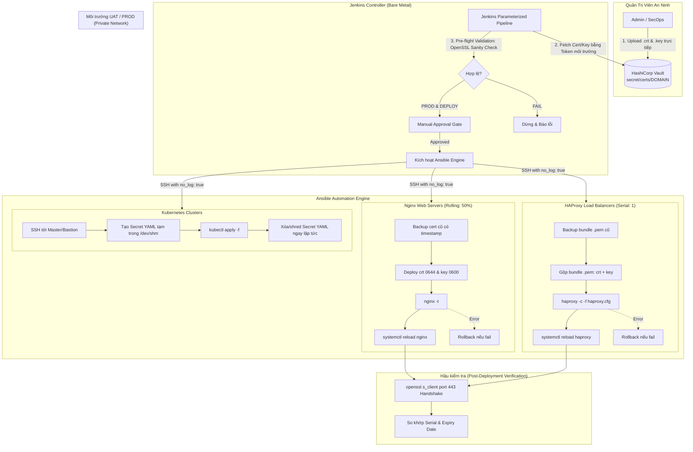

# Enterprise SSL/TLS Certificate Distribution & Automation

Hệ thống tự động hóa quản lý, phân phối và cập nhật chứng chỉ SSL/TLS trên hạ tầng đa nền tảng (Kubernetes, Nginx, HAProxy) tuân thủ các nguyên tắc **DevSecOps**, **Zero Trust**, **Least Privilege** và **Defense in Depth**.

---

## 1. Kiến trúc hệ thống (Architecture Overview)



---

## 2. Các nguyên tắc DevSecOps & Zero Trust cốt lõi

1. **Không rò rỉ Private Key vào CI/CD:**
   - Admin nạp trực tiếp cặp key vào HashiCorp Vault. Không bao giờ truyền Private Key qua tham số (Parameter) của Jenkins hoặc commit vào Git repository.
   - Thư mục tạm trên Jenkins Agent được tạo với quyền `0700` và bị hủy triệt để bằng lệnh `shred -u -z -n 3` trong khối `post { always }`.
2. **Cô lập đặc quyền theo môi trường (Isolation & Least Privilege):**
   - Tách biệt 2 Vault Token trong Jenkins Credential Manager: `vault-token-uat` và `vault-token-prod`.
   - Pipeline tự động chọn đúng Token dựa trên parameter `ENVIRONMENT`.
3. **Phòng vệ theo chiều sâu trong Ansible (Defense in Depth):**
   - Đặt `no_log: true` trên tất cả các task xử lý private key và render secret để ngăn lộ key vào Jenkins console logs.
   - Trên K8s Bastion: Manifest Secret YAML chỉ được tạo trong RAM disk (`/dev/shm`) với quyền `0600`, không ghi xuống ổ đĩa cứng vật lý và bị xóa ngay trong khối `always`.
4. **Độ sẵn sàng cao (High Availability) & Rollback an toàn:**
   - **Nginx:** `serial: 50%` đảm bảo luôn có ít nhất một nửa số node phục vụ lưu lượng; kiểm tra cú pháp `nginx -t` trước khi reload; tự động rollback phiên bản backup nếu cấu hình lỗi.
   - **HAProxy:** `serial: 1` reload từng node load balancer một; kiểm tra `haproxy -c` trước khi reload.
   - **Kubernetes:** Khai báo Secret dưới dạng `kubernetes.io/tls` chuẩn, tương thích với Ingress Controller (Nginx Ingress, Traefik, HAProxy Ingress).

---

## 3. Cấu trúc thư mục dự án

```text
.
├── Jenkinsfile                          # Pipeline chính (Parameterized, Vault, Approval, Ansible)
├── ansible.cfg                          # Cấu hình Ansible tối ưu và bảo mật
├── inventories/
│   ├── uat/
│   │   └── hosts.yml                    # Danh sách server Nginx, HAProxy, K8s Bastion UAT
│   └── prod/
│       └── hosts.yml                    # Danh sách server Nginx, HAProxy, K8s Bastion PROD
├── playbooks/
│   ├── deploy_certs.yml                 # Master playbook điều phối toàn bộ targets
│   └── roles/
│       ├── nginx_cert/                  # Role cập nhật cert cho Nginx
│       │   └── tasks/main.yml
│       ├── haproxy_cert/                # Role cập nhật PEM bundle cho HAProxy
│       │   └── tasks/main.yml
│       ├── k8s_cert/                    # Role cập nhật Secret TLS trên K8s qua Bastion
│       │   ├── tasks/
│       │   │   ├── main.yml
│       │   │   ├── apply_cluster.yml
│       │   │   └── apply_namespace.yml
│       │   └── templates/
│       │       └── tls-secret.yaml.j2
│       └── verify_cert/                 # Role kiểm tra TLS handshake thực tế qua OpenSSL
│           └── tasks/main.yml
└── README.md
```

---

## 4. Hướng dẫn thiết lập hạ tầng

### 4.1. Cấu hình HashiCorp Vault
Lưu chứng chỉ vào Vault KV theo đường dẫn: `secret/certs/<CERT_DOMAIN>`

```bash
# Ví dụ nạp cert cho domain example.com:
vault kv put secret/certs/example.com \
    tls.crt=@fullchain.crt \
    tls.key=@privkey.key
```

### 4.2. Cấu hình Jenkins Credentials
Khai báo 3 Credentials trong Jenkins:
1. `vault-token-uat` (Secret text): Token Vault chỉ có quyền đọc `secret/certs/*` dùng cho UAT.
2. `vault-token-prod` (Secret text): Token Vault chỉ có quyền đọc `secret/certs/*` dùng cho PROD.
3. `ansible-ssh-deploy-key` (SSH Username with private key): Khóa SSH của user `devops` có quyền `sudo` trên các máy chủ mục tiêu.

---

## 5. Quy trình vận hành khi gia hạn chứng chỉ (Runbook)

Khi nhận được cặp file `.crt` và `.key` mới từ Nhà cung cấp chứng thực số (CA):

1. **Bước 1: Nạp vào Vault**
   - Quản trị viên mở Vault UI hoặc chạy lệnh CLI cập nhật chứng chỉ mới vào path `secret/certs/<DOMAIN>`.
2. **Bước 2: Chạy kiểm thử trên UAT**
   - Vào Jenkins Pipeline, chọn:
     - `ENVIRONMENT`: `UAT`
     - `TARGET_PLATFORM`: `ALL`
     - `CERT_DOMAIN`: `<DOMAIN>`
     - `ACTION`: `DEPLOY`
   - Bấm **Build with Parameters**. Pipeline tự động fetch cert, deploy lên UAT Nginx, HAProxy, K8s và kiểm tra live handshake.
3. **Bước 3: Triển khai lên Production**
   - Vào Jenkins Pipeline, chọn:
     - `ENVIRONMENT`: `PROD`
     - `TARGET_PLATFORM`: `ALL` (hoặc từng thành phần nếu muốn chia phase)
     - `CERT_DOMAIN`: `<DOMAIN>`
     - `ACTION`: `DEPLOY`
   - Bấm **Build with Parameters**.
   - Pipeline thực hiện Pre-flight check, sau đó dừng tại bước **Production Approval Gate**.
   - Trưởng nhóm / Quản trị viên kiểm tra lại thông tin và bấm **Approve**.
   - Pipeline triển khai theo cơ chế rolling update, kiểm tra zero-downtime và trả kết quả xác thực.
